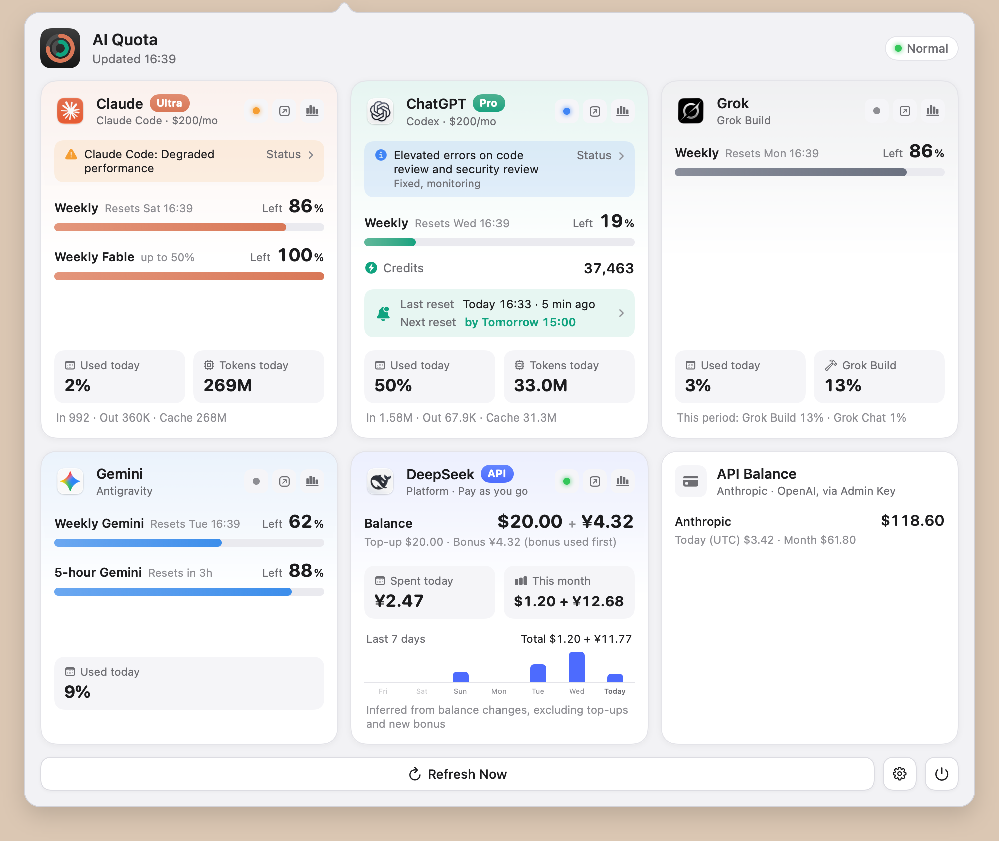

<div align="center">

# AI Quota · AIStatus

[简体中文](README.md) | **English** | [Tiếng Việt](README.vi.md)

See how much Claude Code, Codex, Grok and Gemini quota you have left, plus your DeepSeek, Anthropic and OpenAI API balances, right from the Mac menu bar.

[**⬇️ Download the latest AIStatus.dmg**](https://github.com/Lenka0605/AIStatus/releases/latest/download/AIStatus.dmg)

macOS 14 or later · Universal (Apple silicon and Intel)



</div>

## Features

- **Quota at a glance**: rings and numbers on the menu bar icon show what's left of your Claude Code and Codex weekly quota
- **Subscription quota**: weekly quota, per-model weekly quota (e.g. Fable), reset times, how much of the weekly quota you used today, and tokens used on this Mac today
- **Gemini**: once Antigravity (`agy`) is installed and signed in, shows the weekly and 5-hour quota for Gemini models plus Google AI Credits
- **Grok**: once signed in with the Grok CLI, shows the weekly quota, reset time, and how much Grok Build (coding) and chat each used
- **Codex**: Credits balance, plus the last and next announced "reset for everyone"
- **DeepSeek**: account balance (top-up and bonus shown separately), with today's and this month's spending inferred from balance changes and a 7-day chart
- **Anthropic / OpenAI API**: today's and this month's spending and remaining balance, using an Admin Key
- **Service status**: reads each provider's official status page and flags incidents on the card
- **Notifications**: quota below 20% / 5%, quota reset, low API balance, Codex global reset
- **Multilingual**: Chinese, English and Vietnamese — follows your system language by default, or pick one in Settings › General › Language
- **Auto update**: new versions show up in the panel; one click downloads and installs them
- ⌥⌘A hotkey, launch at login, light and dark appearance

## Install

1. [Download AIStatus.dmg](https://github.com/Lenka0605/AIStatus/releases/latest/download/AIStatus.dmg), open it and drag **AIStatus** into the Applications folder
2. Double-click it. The app isn't signed with an Apple Developer ID, so macOS says it can't verify the developer — click **Done**
3. Open **System Settings › Privacy & Security**, scroll down, click **Open Anyway** and enter your password

   Or run this in Terminal:

   ```bash
   xattr -dr com.apple.quarantine /Applications/AIStatus.app
   ```

4. The icon appears in the menu bar at the top right. Click it to see your quota

Steps 2 and 3 are needed only once. Future versions are offered inside the app — click "Update" and it installs itself.

## Requirements

- **Claude Code** signed in with a Claude account, **Codex** signed in with a ChatGPT account, the **Grok CLI** signed in with `grok login`, and/or **Antigravity** signed in with a Google account — whichever you use is shown
- DeepSeek and Anthropic / OpenAI API balances need a key entered in Settings

## Privacy

- Reads only the Claude Code and Codex sign-in info already on your Mac and talks directly to each provider's official API — no third-party servers
- API keys you enter are stored only in your Mac's Keychain
- No analytics, no data collection

## Build from source

Requires Xcode 16 or later.

```bash
./build.sh            # build build/AIStatus.app
./build.sh --install  # build, install to ~/Applications and launch
./build.sh --dist     # build a universal binary and package build/AIStatus-<version>.dmg
./build.sh --release  # package and publish to GitHub Releases (maintainers)
```

After changing any UI text, run `scripts/l10n.sh` to check that the English and Vietnamese translations are complete.
