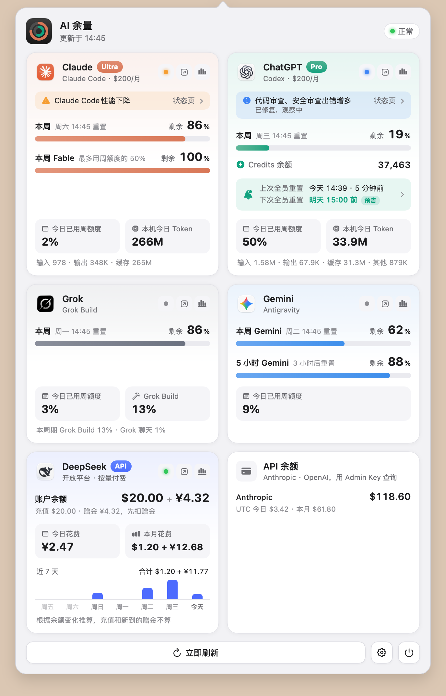

<div align="center">

# AI 余量 · AIStatus

**简体中文** | [English](README.en.md) | [Tiếng Việt](README.vi.md)

在 Mac 状态栏里随时查看 Claude Code、Codex、Grok、Gemini 还剩多少额度，以及 DeepSeek、Anthropic、OpenAI 的 API 余额。

[**⬇️ 下载最新版 AIStatus.dmg**](https://github.com/Lenka0605/AIStatus/releases/latest/download/AIStatus.dmg)

macOS 14 或更新 · Apple 芯片和 Intel 芯片通用



</div>

## 功能

- **状态栏一眼看余量**：图标上的圆环和数字显示 Claude Code、Codex 本周还剩多少
- **订阅额度**：本周额度、单个模型（如 Fable）的周额度、重置时间、今天用掉了多少周额度、本机今天用了多少 Token
- **Gemini**：本机装了 Antigravity（`agy`）并登录后，显示 Gemini 模型的每周和 5 小时额度、Google AI Credits
- **Grok**：用 Grok CLI 登录后显示本周额度、重置时间，以及 Grok Build（写代码）和聊天各用了多少
- **Codex**：Credits 余额，以及「全员重置」的上次时间和下次预告
- **DeepSeek**：账户余额（充值、赠金分开显示），按余额变化推算今日、本月花费和近 7 天柱状图
- **Anthropic / OpenAI API**：填 Admin Key 后显示当天、当月花费和剩余余额
- **服务状态**：读取各家官方状态页，出故障时卡片上会提示
- **提醒**：额度低于 20%、5%，额度恢复，API 余额不足，Codex 全员重置时发系统通知
- **多语言**：中文、英语、越南语，默认跟随系统语言，也可以在「设置 › 通用 › 语言」里单独指定
- **自动更新**：有新版本时在面板上提示，点一下自动下载安装
- 快捷键 ⌥⌘A 打开面板、开机自动启动、浅色/深色外观

## 安装

1. [下载 AIStatus.dmg](https://github.com/Lenka0605/AIStatus/releases/latest/download/AIStatus.dmg)，打开后把 **AIStatus** 拖到「应用程序」文件夹
2. 双击打开。因为没有苹果开发者签名，系统会提示「无法验证开发者」，点 **完成**
3. 打开 **系统设置 › 隐私与安全性**，拉到下面，点 **仍要打开**，输入开机密码

   也可以在终端运行：

   ```bash
   xattr -dr com.apple.quarantine /Applications/AIStatus.app
   ```

4. 图标会出现在屏幕右上角的状态栏里，点它查看额度

第 2、3 步只需要做一次。以后的新版本会在应用里提示，点「更新」就会自动安装。

## 使用前提

- 用 **Claude Code** 登录过 Claude 账号、用 ChatGPT 账号登录过 **Codex**，用 `grok login` 登录过 **Grok CLI**，或装了 **Antigravity** 并登录 Google 账号，哪家登录了就显示哪家
- DeepSeek 和 Anthropic / OpenAI API 余额需要在设置里填写 Key

## 隐私

- 只读取本机已有的 Claude Code、Codex 登录信息，直接请求各家官方接口，不经过任何第三方服务器
- 你填写的 API Key 只保存在本机的钥匙串里
- 不收集、不上传任何使用数据

## 从源码编译

需要 Xcode 16 或更新版本。

```bash
./build.sh            # 编译成 build/AIStatus.app
./build.sh --install  # 编译并安装到 ~/Applications，然后启动
./build.sh --dist     # 编译通用版本，打包成 build/AIStatus-<版本>.dmg
./build.sh --release  # 打包并发布到 GitHub Releases（维护者用）
```

改了界面文字以后，运行 `scripts/l10n.sh` 检查英语、越南语翻译是否齐全。
