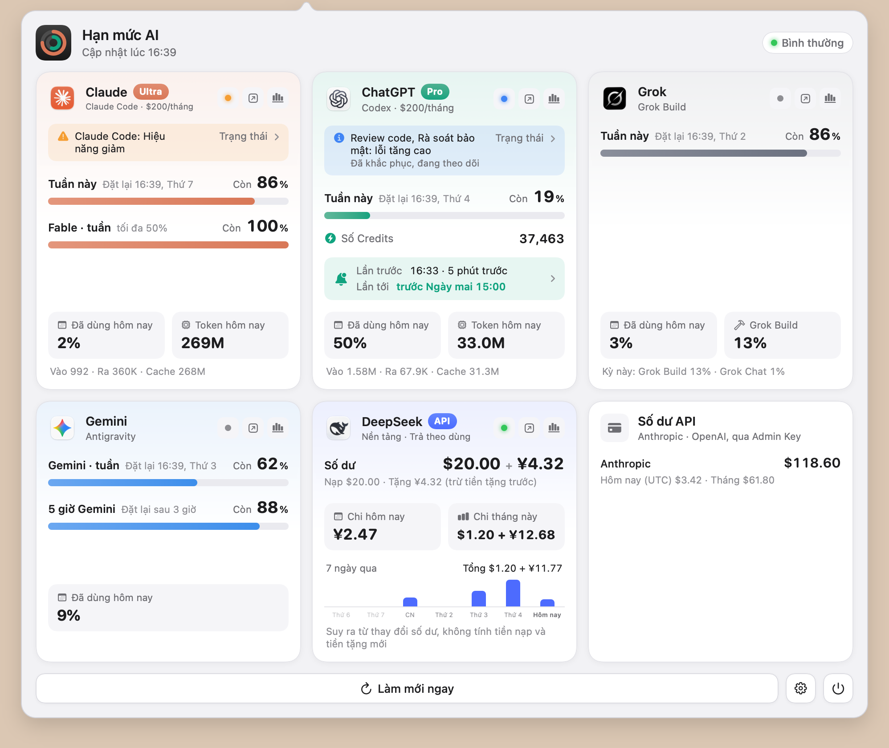

<div align="center">

# Hạn mức AI · AIStatus

[简体中文](README.md) | [English](README.en.md) | **Tiếng Việt**

Xem nhanh hạn mức còn lại của Claude Code, Codex, Grok, Gemini và số dư API của DeepSeek, Anthropic, OpenAI ngay trên thanh menu của Mac.

[**⬇️ Tải AIStatus.dmg mới nhất**](https://github.com/Lenka0605/AIStatus/releases/latest/download/AIStatus.dmg)

macOS 14 trở lên · Hỗ trợ cả chip Apple và Intel



</div>

## Tính năng

- **Xem hạn mức trong nháy mắt**: vòng tròn và con số trên biểu tượng thanh menu cho biết hạn mức tuần của Claude Code, Codex còn bao nhiêu
- **Hạn mức gói đăng ký**: hạn mức tuần, hạn mức tuần riêng của từng mô hình (ví dụ Fable), thời gian đặt lại, phần hạn mức tuần đã dùng hôm nay và số token đã dùng trên máy này hôm nay
- **Gemini**: sau khi cài và đăng nhập Antigravity (`agy`), hiện hạn mức tuần và 5 giờ của các mô hình Gemini cùng Google AI Credits
- **Grok**: sau khi đăng nhập Grok CLI, hiện hạn mức tuần, thời gian đặt lại và phần đã dùng của Grok Build (viết code) và chat
- **Codex**: số Credits, thời điểm "đặt lại cho mọi người" lần trước và lần tới
- **DeepSeek**: số dư tài khoản (tách riêng tiền nạp và tiền tặng), chi tiêu hôm nay, tháng này được suy ra từ thay đổi số dư, kèm biểu đồ 7 ngày
- **API Anthropic / OpenAI**: chi tiêu hôm nay, tháng này và số dư còn lại, dùng Admin Key
- **Trạng thái dịch vụ**: đọc trang trạng thái chính thức của từng nhà cung cấp, báo ngay trên thẻ khi có sự cố
- **Thông báo**: hạn mức dưới 20% / 5%, hạn mức được đặt lại, số dư API thấp, Codex đặt lại cho mọi người
- **Đa ngôn ngữ**: tiếng Trung, tiếng Anh, tiếng Việt — mặc định theo ngôn ngữ hệ thống, hoặc tự chọn trong Cài đặt › Chung › Ngôn ngữ
- **Tự động cập nhật**: có phiên bản mới sẽ hiện trên bảng, một cú nhấp để tải và cài
- Phím tắt ⌥⌘A, mở khi đăng nhập, giao diện sáng/tối

## Cài đặt

1. [Tải AIStatus.dmg](https://github.com/Lenka0605/AIStatus/releases/latest/download/AIStatus.dmg), mở ra rồi kéo **AIStatus** vào thư mục Applications
2. Nhấp đúp để mở. Ứng dụng chưa có chữ ký Apple Developer ID nên macOS báo không xác minh được nhà phát triển — nhấn **Xong**
3. Mở **Cài đặt hệ thống › Quyền riêng tư & Bảo mật**, cuộn xuống, nhấn **Vẫn mở** và nhập mật khẩu máy

   Hoặc chạy lệnh này trong Terminal:

   ```bash
   xattr -dr com.apple.quarantine /Applications/AIStatus.app
   ```

4. Biểu tượng sẽ xuất hiện trên thanh menu ở góc trên bên phải. Nhấn vào để xem hạn mức

Bước 2 và 3 chỉ cần làm một lần. Các phiên bản sau sẽ được thông báo ngay trong ứng dụng — nhấn "Cập nhật" là tự cài.

## Yêu cầu

- Đã đăng nhập **Claude Code** bằng tài khoản Claude, **Codex** bằng tài khoản ChatGPT, **Grok CLI** bằng `grok login`, hoặc **Antigravity** bằng tài khoản Google — dùng dịch vụ nào thì hiện dịch vụ đó
- Số dư API của DeepSeek và Anthropic / OpenAI cần nhập Key trong Cài đặt

## Quyền riêng tư

- Chỉ đọc thông tin đăng nhập Claude Code, Codex có sẵn trên máy và gọi thẳng API chính thức của từng nhà cung cấp, không qua máy chủ bên thứ ba
- API Key bạn nhập chỉ được lưu trong Keychain của máy
- Không thu thập, không gửi đi bất kỳ dữ liệu sử dụng nào

## Tự biên dịch

Cần Xcode 16 trở lên.

```bash
./build.sh            # biên dịch ra build/AIStatus.app
./build.sh --install  # biên dịch, cài vào ~/Applications rồi mở
./build.sh --dist     # biên dịch bản universal và đóng gói build/AIStatus-<phiên bản>.dmg
./build.sh --release  # đóng gói và phát hành lên GitHub Releases (dành cho người duy trì)
```

Sau khi sửa chữ trên giao diện, chạy `scripts/l10n.sh` để kiểm tra bản dịch tiếng Anh, tiếng Việt đã đủ chưa.
